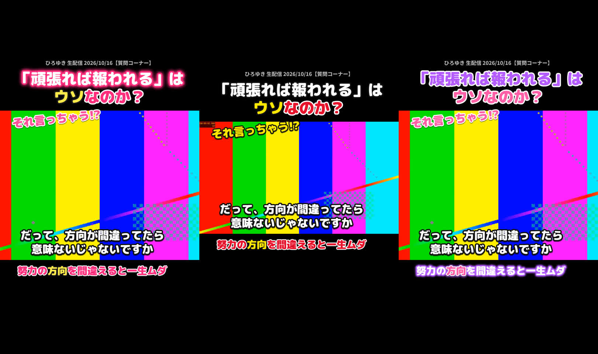
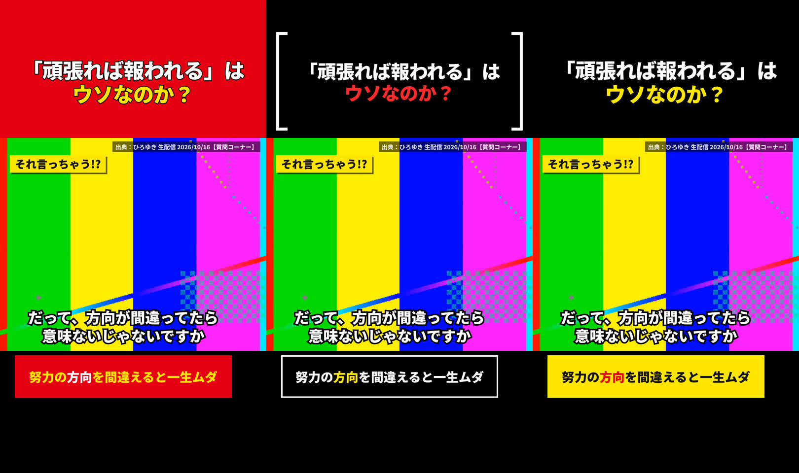
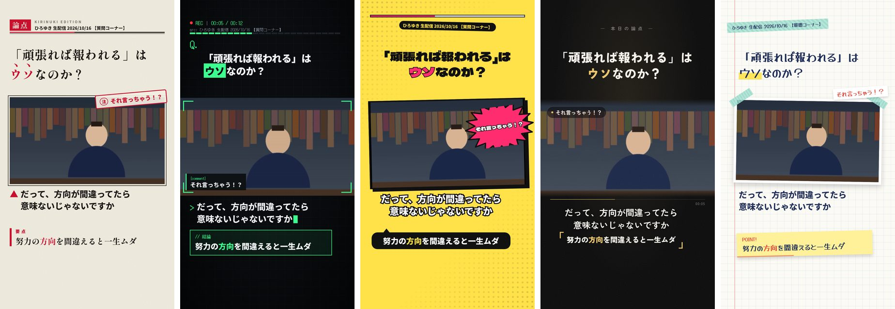

# Shorts design templates

## Default: `telop` (standard clip-Shorts layout)

Since 2026-11-18 every new clip uses `telop`, modelled on the layout shared by most outlier clip
Shorts in YouTube Studio's research tab (ショート動画 › 自分のジャンルのブレイク動画):

- black canvas, no decoration;
- a two-tone headline in heavy rounded gothic (M PLUS Rounded 1c 900), thick outline, lines
  alternating between two inks, emphasised words in a third, hugging the top of the clip;
- the source title as a small kicker line above the headline;
- the clip edge to edge, cropped to 4:3 (`zoom`) so faces are bigger, or full frame (`wide`);
- the spoken line burned in over the bottom edge of the clip (white, black outline);
- reactions as a tilted outlined cut-in on the clip;
- the punchline as a second outlined line under the clip.

Three variants rotate (pink glow / zoom, red-white / wide, lavender / zoom). The five themed
templates below stay available: `KIRINUKI_DESIGN_POOL=all` (or a comma list such as
`pop,cinema`) brings back the old rotation, and `KIRINUKI_DESIGN_TEMPLATE` still pins one.

## ひろゆき lane: `ronpa` (debate / news caption layout)

The 恋リア-tuned `telop` look doesn't match the Hiroyuki niche, so the ひろゆき lane
(`direct-tertiary.yml`, `KIRINUKI_DESIGN_POOL: ronpa`) uses its own template, modelled on the
outliers in the research tab of the Hiroyuki clip channel (2026-11-18: ひろゆき・ホリエモン・
令和の虎・政治討論 clips at 10–100x):

- square heavy gothic (Noto Sans JP 900), no rounded or glowing type;
- the headline as a claim or question, line 1 white and line 2 yellow/red, on a solid red band,
  inside big white brackets, or plain on black;
- the speaker cropped tight (5:4) so the face fills the middle;
- the spoken line burned in white with a black outline over the lower clip;
- reactions as a flat yellow caption tag; a small 「出典：…」 credit on the clip;
- the punchline on a solid plate under the clip (red/yellow, or black with a white frame).

## Themed templates (previous default)

Every clip is rendered with one of five templates so that consecutive uploads don't share a
single visual identity. Each template is a different editorial concept, not a recolour:

| id | concept | headline | how subtitles appear | punchline | reaction |
|---|---|---|---|---|---|
| `gougai` | 号外 / newspaper page | Shippori Mincho with 傍点 on emphasised words | photo caption (▲) | pull quote 「要点」 | editor's stamp 「注」 |
| `terminal` | 発言ログ / debate console | "Q." + Noto Sans JP, emphasis as highlighted blocks | typed-in log line with cursor | `// 結論` panel | `[comment]` log chip |
| `pop` | 雑誌表紙 / pop magazine cover | Dela Gothic One, emphasis in outlined hot colour | heavy outlined manga caption | black speech bubble | starburst sticker |
| `cinema` | シネマ / quiet film | Zen Kaku Gothic, blur-in | boxless, centred | quoted line in 「」 | translucent pill |
| `note` | ノート / study notebook | Yusei Magic with a highlighter swipe | written under a taped photo | sticky note "POINT!" | handwritten slip |

Each template also has 2–3 colour variants, and small per-clip differences (tilt direction,
paper/grain pattern) come from `designSeed`.

## Rotation

`packages/design_rotation.py` picks a template per clip, least-recently-used first:

- the same template is never used twice in a row;
- all five are used before any repeats, in a seeded order per cycle (no fixed A→B→C→D→E pattern);
- colour variants rotate the same way inside each template.

The direct lane passes the designs of previous uploads from the `kirinuki-state` ledger
(`KIRINUKI_DESIGN_HISTORY`) and records each clip's design in the ledger (`design` field), so the
rotation continues across runs. Lanes without a ledger still rotate within each run.

`KIRINUKI_DESIGN_TEMPLATE=<id>[:<variant>]` pins every clip to one design (useful for previews).

## Layout rules shared by all templates

- Readable text stays inside the Shorts-safe box (`SAFE` in `shared.tsx`): nothing important
  below y≈1615 or under the right-hand button column, where the YouTube player draws its UI.
- The headline is fully readable on frame 0; entrance animations never start from blank.
- Japanese text uses phrase-aware line breaking (`word-break: auto-phrase`), so words like
  結婚 or ひろゆき are not split across lines, and font sizes are fitted to the box.
- Fonts are bundled (Fontsource) and frames wait for the exact glyphs they need.
- No per-frame noise: animated grain wrecks compression after YouTube's re-encode.

## Adding a template

1. Add `apps/remotion/src/design/templates/<Name>.tsx` exporting the component and a `PALETTES`
   array, and register it in `registry.ts`.
2. Add the same id and palette count to `TEMPLATE_VARIANTS` in `packages/design_rotation.py`
   (`tests/test_design_rotation.py` fails if the two disagree).
3. Never rename an existing id: it's stored in the publish ledger.
